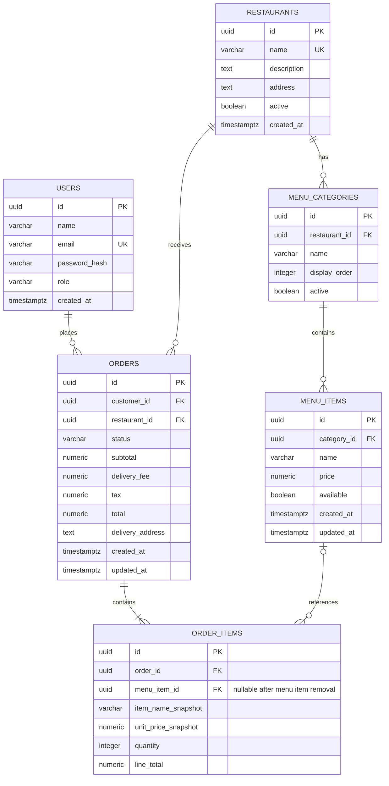

# Initial data model

The MVP uses UUID primary keys and PostgreSQL `TIMESTAMPTZ` timestamps stored in UTC. All prices and totals use `NUMERIC(12, 2)` / Java `BigDecimal`, in INR. The checkout flow has no real payment integration yet, so a `payments` table is deferred until a payment method needs persistent payment state.

Order items retain the purchased name and unit price. The menu-item foreign key uses `ON DELETE SET NULL`, while order rows and restaurants are restricted from deletion where they would erase order history. Application code should deactivate restaurants, categories, and items instead of deleting them during normal operation.

Local sample restaurant data is inserted only when the backend runs with the explicit `development` Spring profile. It creates no user accounts or credentials.
